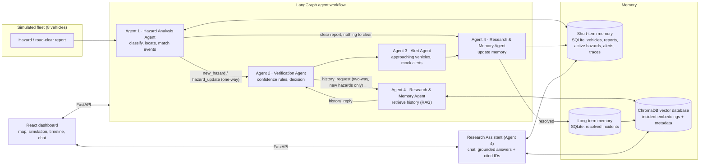

# Autonomous Vehicle Intercommunication Safety Agent System

**Author:** Kiran Haridas · **Program:** Carnegie Mellon University Agentic AI · **Agent option:** Research Assistant

**Repository:** [github.com/kirankh7/Autonomous-Safety-Agent-System](https://github.com/kirankh7/Autonomous-Safety-Agent-System)

An educational agentic AI application in which simulated autonomous vehicles share hazard reports. Agents
verify the reports, warn only the vehicles heading toward the hazard, learn from feedback, and explain
every decision with cited evidence.

> **Simulation only.** All vehicles, roads, incidents and alerts are synthetic. Alerts are advisory and never
> control a vehicle. The confidence rules are demonstration rules, not automotive safety standards.

---

## 1. The problem

An autonomous vehicle normally decides using only its own sensors. In dense fog, a vehicle cannot see a
stopped truck 500 m ahead, even though another vehicle that is already beside the truck can. This system is a
**shared safety intelligence layer**: it collects reports from the fleet, checks whether they are reliable, and
sends warnings to the vehicles that need them.

A single LLM prompt is not enough for this. The agent has to:
- link reports that arrive at different times;
- track confidence as evidence comes in;
- work out which vehicles are actually on an affected path;
- retract a hazard when the road is clear;
- remember outcomes for next time.

## 2. Architecture



| Layer | Technology |
|---|---|
| Backend API | Python, FastAPI |
| Agent workflow | LangGraph (`backend/agents.py`) |
| Memory | SQLite (`backend/memory.py`, `backend/database.py`) |
| RAG / vector DB | ChromaDB (persistent, local) with all-MiniLM-L6-v2 embeddings; FAISS + TF-IDF offline fallback (`backend/rag.py`) |
| LLM | Mock by default; optional local model through Ollama, Anthropic or OpenAI (`backend/llm.py`) |
| Frontend | React + Vite + TypeScript, Tailwind CSS, Recharts, Leaflet with OpenStreetMap |
| Data | JSON files in `data/`: 8 vehicles (named Tesla Model 3, Toyota Prius, Ford Transit, Mercedes Sprinter, Jaguar I-PACE, Volvo Truck, Hyundai Ioniq 5, Nissan Leaf), 5 road segments, 20 incidents, 7 scenarios, plus random dummy traffic from the Playground |

```
autonomous-vehicle-agent/
├── backend/
│   ├── main.py         FastAPI endpoints
│   ├── agents.py       LangGraph workflow (agents 1-4) and process_report()
│   ├── tools.py        agent tools, MCP-style tool registry, confidence rules, road geometry
│   ├── memory.py       short-term and long-term memory
│   ├── rag.py          vector database (ChromaDB / FAISS), metadata filter, MMR
│   ├── research.py     Research Assistant (grounded Q&A with evidence IDs)
│   ├── llm.py          mock / Anthropic / OpenAI answer phrasing
│   ├── simulation.py   step-by-step scenario runner
│   ├── benchmark.py    coordination benchmark (hybrid vs one-way vs sequential vs no-verifier)
│   ├── playground.py   custom reports and random dummy traffic
│   └── database.py     SQLite schema and helpers
├── frontend/src/       App.tsx, pages/, components/
├── data/               roads.json, vehicles.json, incidents.json, scenarios.json
├── tests/              pytest tests
├── requirements.txt
└── .env.example
```

## 3. How the agent system works

Each vehicle report is one run through the LangGraph:

1. **Hazard Analysis Agent.** Classifies the hazard type and turns "500 m ahead" into a position on the road.
   It then calls `find_matching_hazards()` to check whether the hazard is already being tracked (same segment,
   same carriageway, within 50 m, or within 150 m for a related obstruction such as a stopped truck and the
   debris it shed). If it is, it loads the earlier reports with `get_vehicle_reports()`.
   Otherwise it opens a new hazard event.
2. **Verification Agent ⇄ Research & Memory Agent (two-way, new hazards only).** A new hazard has only one
   report, so Verification first sends a `history_request`. Research & Memory calls
   `retrieve_similar_incidents()`, computes a small, capped history adjustment and sends a `history_reply`; the
   graph then loops back to Verification. If retrieval fails, the reply says "unavailable" and Verification
   scores on the rules alone (failover), so the vector database can never block a warning.
3. **Verification Agent.** Calls `verify_hazard()`, which applies the confidence rules and chooses an action.
4. **Alert Agent.** Calls `find_approaching_vehicles()` to find vehicles on the same segment and direction,
   behind the hazard and within 3 km. It then sends messages with `send_mock_alert()`:
   - a verified alert;
   - a caution advisory;
   - an observation request ("please report what you see");
   - an all-clear once the hazard is resolved.

   Vehicles on the opposite carriageway, or already past the hazard, are not alerted. A vehicle never gets
   the same message type twice.
5. **Research & Memory Agent (update).** Calls `update_hazard_memory()` to save the report and hazard. When a
   hazard is resolved, it writes the outcome to long-term memory and adds it to the vector database.

### Confidence rules

| Event | Effect |
|---|---|
| First report | confidence = 0.50 |
| Independent confirmation (different vehicle, within 2 minutes) | +0.20 |
| A vehicle reports the road is clear | −0.30 |
| Each similar past incident that was confirmed / was a false report | +0.05 / −0.05 (total capped at ±0.15) |

Confidence is always kept between 0 and 1.

| Result | Decision |
|---|---|
| ≥ 0.60 | **Verified alert** |
| 0.40 – 0.60 | **Caution advisory** |
| < 0.40 | **Wait for more evidence**: send observation requests to approaching vehicles |
| 2 independent clear reports, or a clear report drops confidence below 0.20 | **Resolve** the hazard |

Three further rules:
- **Safety exception:** a high-severity hazard in visibility under 200 m always gets at least a caution advisory.
- **Low visibility:** visibility under 200 m raises severity by one level.
- **Escalation (failover to a human):** if at least two vehicles confirmed a hazard, another reported it clear,
  and that conflict has lasted 2 minutes without being settled, the agents stop requesting observations and the
  Alert Agent sends one **operator escalation** to the fleet operator. This is the lab's "iteration loop with a
  retry limit, then failover" pattern, applied to the agents' observation loop.

## 4. Agentic AI concepts demonstrated

### ReAct
Every node follows **Reason, then Act with a tool, then Observe the result**, and the observation decides the
next step. Each step is written to an execution trace that shows four fields: Reason, Action, Tool and Result.
The Agent Activity page displays this trace. For example:

- **Reason:** "Does this report describe a hazard we are already tracking?"
- **Action:** `find_matching_hazards(ROAD-01, forward, 3500, stopped_truck)`
- **Observation:** "Match found: HZ-001 (confidence 0.50)"
- **Next:** load the earlier reports, then verify.

The LangGraph's conditional edges are ReAct decisions: what Hazard Analysis observes decides whether the report
goes to verification or is only recorded, and whether the hazard is new decides whether Verification asks for
history first.

The decisions themselves use transparent rules, so they are easy to test and explain. The trace records the
agent's decisions, tool calls and results; it does not contain hidden model reasoning.

### Multi-agent coordination and communication (Checkpoint 5.1)
- **Coordination: hybrid graph.** A sequential fast path (Analysis → Verification → Alert → Memory) with
  conditional edges for the two cases that need them: nothing to clear, and the history loop for new hazards.
  Routing depends only on state, so the same reports always take the same path.
- **Communication: typed messages.** Every handoff is a message with sender, receiver, kind and protocol, stored
  in SQLite and shown under **Agent messages** on the Simulation and Agent Activity pages (`GET /api/messages`).
  - *One-way:* `new_hazard`, `hazard_update`, `decision`, `alerts_sent`, alerts to vehicles.
  - *Two-way:* `history_request` / `history_reply` between Verification and Research & Memory, and
    `observation_request` → `observation_reply` with the fleet (a vehicle's next report is linked to the request
    it answers).
- **Coordination benchmark** (the lab's Part D, on this project's data). `python -m backend.benchmark`, or
  **Run benchmark** on the Fleet Dashboard, runs all seven scenarios (25 reports) under four configurations in a
  temporary database. `one_way` is the lab's one-way protocol: the same agents, but Verification never asks for
  history.

  | Configuration | RAG calls | ms / report | False warnings | Escalations | Same decisions |
  |---|---|---|---|---|---|
  | `hybrid` (production graph) | 9 | ~26 | 0 | 1 | 25/25 |
  | `one_way` (no history request) | 0 | ~8 | 1 | 1 | 20/25 |
  | `sequential` (every agent on every report) | 25 | ~47 | 0 | 1 | 25/25 |
  | `single_pass` (no verifier) | 0 | ~12 | 1 | 0 | 12/25 |

  A false warning is a verified alert or caution advisory about a hazard that was not real. Latency depends on
  the machine (measured with ChromaDB).
- **Graph view.** Agent Activity draws the coordination graph; `GET /api/graph` returns the compiled LangGraph
  as Mermaid, the way the lab renders it with `get_graph()`.

### Tool usage
Agents call tools by name through one MCP-style interface, `call_tool()` in `backend/tools.py`. It validates
arguments against the tool's signature, wraps failures in `ToolError` so the calling agent can fail over, and
counts calls for the benchmark. `GET /api/tools` lists the registry. The tools are plain Python functions:
- `get_vehicle_reports()`
- `find_matching_hazards()`
- `verify_hazard()`
- `find_approaching_vehicles()`
- `retrieve_similar_incidents()`
- `send_mock_alert()`
- `update_hazard_memory()`
- `history_adjustment()`

### Memory
- **Short-term memory** holds the live situation: vehicle positions, reports, active hazards, alerts sent and
  traces. It is what links Toyota Prius's confirmation to Tesla Model 3's report 40 seconds earlier, and what stops
  duplicate alerts. **Reset Scenario** clears it.
- **Long-term memory** holds resolved incidents: 20 synthetic historical incidents plus every incident the agent
  learns during the session, each with its outcome (confirmed or false report) and a lesson. It persists across
  scenarios. **Reset All Memory** restores the 20 seed incidents.

### RAG
- **Chunks:** each incident is one chunk, a metadata header followed by the narrative, for example
  `flooding | underpass | heavy rain [SEP] Standing water across both lanes...`. Prefixing the title like this
  follows Dense Passage Retrieval (Karpukhin et al., 2020).
- **Vector database: ChromaDB.** Each chunk is stored with its embedding and metadata (hazard type, segment,
  outcome, source).
  - Embeddings come from `all-MiniLM-L6-v2`, a 384-dimensional sentence model that ChromaDB runs locally. It
    downloads once, about 80 MB.
  - Similarity is cosine.
  - The database persists on disk in `chroma_db/`.
  - SQLite remains the source of truth for incidents. ChromaDB is kept in sync: learned incidents are added, and
    a full memory reset removes them.
  - **Fallback:** set `VECTOR_DB=faiss` to run fully offline with a FAISS index over TF-IDF vectors. The app
    also switches to this automatically if ChromaDB can't start. All scenario scores are the same on both.
- **Retrieval:** the hazard-type **metadata filter runs inside the vector query**
  (`where={"hazard_type": ...}`), then a similarity threshold, then ranking:
  - **Confidence scoring** uses the top 3 by pure relevance with a strict threshold (cosine ≥ 0.75), because
    this is a narrow, precision-critical query.
  - **Research questions** use the top 5 with **MMR** (λ = 0.5, Carbonell & Goldstein, 1998) and a looser
    threshold (≥ 0.45), so a broad question gets varied incidents instead of near-duplicates.
- **Cold start (Checkpoint 3.1):** semantic retrieval only changes confidence on segments with fewer than 3 past
  incidents. Segments with their own history use an exact lookup of that history instead. Live evidence always
  outweighs history: one road-clear report (−0.30) beats the full ±0.15 history effect.

The **Flooding** scenario shows retrieval changing the outcome. Without retrieval the score would be 0.50, a
caution advisory. With three similar confirmed underpass floods retrieved, it becomes 0.65, a verified alert
telling the vehicle to reroute.

### Feedback loop
Road-clear reports lower confidence and resolve hazards. The resolved outcome is stored in long-term memory and
added to the vector database, so the next similar report is scored with that outcome. For example, after the fog
scenario, I-580 has a confirmed stopped-truck incident of its own. Replaying the scenario without resetting
memory starts at 0.55 instead of 0.50.

### Research Assistant (agent option)
The chat answers questions using stored event data and retrieved incidents, never invented facts. Every answer
lists the record IDs it used as evidence:
- `HZ-…` hazards
- `RPT-…` reports
- `ALT-…` alerts
- `INC-…` incidents

It runs in one of three modes:

- **Rule-based (default, no API key).** Keyword rules pick the question type, then the answer is assembled from
  the matching records.
- **Claude tool-calling agent (`LLM_PROVIDER=anthropic`).** Claude gets eight read-only tools over memory
  (`list_hazards`, `get_hazard`, `get_vehicle_reports`, `get_alerts`, `get_vehicle`,
  `find_approaching_vehicles`, `retrieve_similar_incidents`, `list_learned_incidents`). It decides which tools to
  call and in what order: a ReAct loop of reason, call a tool, observe the result, repeat
  (`backend/research_agent.py`).
  - The dashboard shows every tool call Claude made.
  - A citation check flags any ID in the answer that no tool returned.
  - If the API call fails, the rule-based answer is shown instead.

- **Local model, free (`LLM_PROVIDER=ollama`).** A model running on your own machine, through Ollama's
  OpenAI-compatible API. No API key, and no data leaves the computer. The rules pick and retrieve the records,
  then the local model only phrases the answer (`llm._local`). Any answer that cites an ID the records did not
  contain, is cut off, or times out is replaced by the grounded rule-based answer. Answers take about 2 seconds
  with `qwen2.5:7b` on an Apple Silicon Mac.
  Setup:
  ```bash
  brew install ollama && ollama serve        # or download Ollama from ollama.com
  ollama pull qwen2.5:7b                     # about 4.7 GB
  # in autonomous-vehicle-agent/.env
  LLM_PROVIDER=ollama
  ```
  On Apple Silicon, Ollama uses the GPU through Metal with no extra settings (check with `ollama ps`: it
  should say 100% GPU). Set `OLLAMA_MODEL` to use another model.
  *Experimental:* `OLLAMA_MODE=agent` lets the local model run the tool-calling loop (`ask_local`). In testing
  a 7B model was too unreliable at choosing tools and citing records, so it is off by default.

**Design choice:** the LLM is autonomous only on the research side. Safety decisions (confidence, alerts) stay
rule-based and deterministic. Claude can read memory, but it cannot send alerts or change scores.

## 5. How to run

**Requirements:** Python 3.10+ (tested on 3.12 and 3.14) and Node.js 20+. No API keys are needed.

```bash
git clone https://github.com/kirankh7/Autonomous-Safety-Agent-System.git
cd Autonomous-Safety-Agent-System/autonomous-vehicle-agent

# Backend
python3 -m venv .venv
source .venv/bin/activate
pip install -r requirements.txt
uvicorn backend.main:app --reload --port 8000

# Frontend (second terminal)
cd frontend
npm install
npm run dev            # opens http://localhost:5173 (proxies /api to port 8000)
```

**Single-server option:** run `npm run build` in `frontend/`, then start uvicorn. The backend serves the
dashboard at http://localhost:8000.

**Claude agent mode (optional):**
1. Copy `.env.example` to `.env`.
2. Set `LLM_PROVIDER=anthropic` and `ANTHROPIC_API_KEY=<your key>`. The default model is `claude-opus-5-5`;
   change it with `ANTHROPIC_MODEL`.
3. Restart uvicorn. The sidebar then shows `LLM: anthropic agent (...)`.

To go through an API gateway instead of a direct key, set `ANTHROPIC_BASE_URL` (the gateway URL),
`ANTHROPIC_API_KEY_HELPER` (a command that prints a token, run at request time and cached for 5 minutes) and,
if needed, `ANTHROPIC_CA_BUNDLE` (a corporate CA certificate file).

Without a key it stays in rule-based mode. (`LLM_PROVIDER=openai` with `OPENAI_API_KEY` is also supported, but
there the model only rewords the rule-based answer.)

**Tests:**

```bash
pytest -q
```

The tests check that:
- hazard reports are processed;
- independent confirmations raise confidence;
- clear reports lower confidence and resolve hazards;
- only approaching vehicles are alerted;
- historical incidents can be retrieved;
- retrieval changes a cold-start decision;
- research answers cite records that actually exist;
- a full scenario runs through the API;
- a new hazard uses the two-way history loop, and updates skip it;
- a retrieval failure fails over to the rules without blocking the alert;
- the tool registry rejects unknown tools and bad arguments;
- an observation reply is linked to its request;
- a related obstruction 80 m away joins the same hazard, and one 200 m away does not;
- the benchmark finds no false alerts for the hybrid graph, and the live database is untouched;
- conflicting reports are escalated to the fleet operator exactly once, and settled conflicts are not;
- two hazards on different roads and carriageways are tracked separately;
- random Playground traffic is reproducible with a seed, and custom reports and vehicle moves work through the API.

## 6. Demonstrating the scenarios

Open **Hazard Simulation**, click a scenario card, then press **Next Step** to advance one agent decision at a
time. Each step shows the agents' signals (for example `NEW HAZARD`, `HISTORY +0.15`, `VERIFIED 0.50 → 0.70`,
`ALERT → Ford Transit`), the confidence, the alerts sent and the live map. Click a trace step to see its full reasoning. **Reset Scenario** restarts the
current scenario. **Reset All Memory** also forgets incidents learned during the session, so the numbers below
are reproduced exactly.

| # | Scenario | What to point out |
|---|---|---|
| 1 | **Stopped truck in fog** (main demo) | Tesla Model 3 reports, 0.50 (caution advisory to Ford Transit) → Toyota Prius confirms, 0.70 (**verified alert** to Ford Transit, 1.1 km away). Mercedes Sprinter on the opposite carriageway is not alerted. Ask "Why was an alert generated for Ford Transit?" → two road-clear reports bring it to 0.40, then **resolved**. An all-clear is sent and the incident is stored as `INC-021`. |
| 2 | **Road accident** | I-680 has its own accident history (+0.10), so the first report is already 0.60. Two confirmations take it to 1.00. Northbound Jaguar I-PACE is not alerted. |
| 3 | **Flooding** | Cold-start road: RAG retrieves 3 confirmed underpass floods (+0.15), so 0.65 gives a **verified alert: reroute**. The trace shows "Without retrieval the score would be 0.50 (caution advisory)". |
| 4 | **False hazard report** | A radar-only debris report: similar past radar-only reports were false (−0.15), so 0.35 means **wait**. A look request goes to Volvo Truck. Volvo Truck reports clear, 0.05, resolved as a **false report** and learned. |
| 5 | **Road cleared** | Confirmed debris on Dublin Blvd, then two independent clear reports resolve it. Ask "What has long-term memory learned from feedback?" |
| 6 | **Conflicting reports** | Tesla Model 3 reports a truck (0.50), Toyota Prius reports debris 80 m further on, matched as the same obstruction (0.70, verified). Volvo Truck reports clear (0.40). Hyundai Ioniq 5 sees the truck again 140 s later, too late to count as a confirmation, so it stays 0.40 and the conflict has now lasted over 2 minutes: **ESCALATED → Fleet operator**. Ask "Why was the hazard escalated?" A second clear report resolves it, and the all-clear also reaches the operator. |
| 7 | **Two hazards at once** | A pothole on Dublin Blvd (0.55 → 0.75) and a stopped vehicle on I-680 southbound (0.50 → 0.70) are tracked and alerted independently. The Jaguar I-PACE's northbound report becomes its own hazard, because only vehicles on the same carriageway are affected. |

### Playground: your own reports and dummy traffic
Open **Playground** to experiment beyond the scripted scenarios:
- **Generate dummy traffic:** 1, 5 or 20 random reports. Random vehicles report random hazards in random weather,
  and other vehicles are placed behind active hazards to confirm them or report the road clear. This gives you
  verification, look requests, escalations, resolutions and learned incidents. Enter a **seed** to get the
  same traffic again.
- **Send your own report:** pick a vehicle (optionally move it to any road, direction and position first), a
  hazard type, distance, weather and visibility. Reports arrive 30 s apart on a simulated clock.
- Every result shows the agents' signals, alerts, messages and full ReAct trace. **Reset playground** clears
  hazards and alerts and puts the vehicles back; learned incidents stay in long-term memory.

API equivalents: `POST /api/playground/random?count=5&seed=42`, `POST /api/playground/report`,
`POST /api/vehicles/{id}/move`, `POST /api/playground/reset`.

The other pages:
- **Agent Activity** has each run as a seven-stage pipeline. Click a stage to focus on it; skipped stages are
  dashed. Below it, **Agent messages** lists the one-way and two-way messages the agents exchanged. At the top,
  the coordination graph shows which edges always run, which are conditional, and which are two-way.
- **Vehicle Map**: click a vehicle or hazard for its details.
- **Fleet Dashboard** has the summary charts and the coordination benchmark.
- **Research Assistant** lets you ask your own questions.

## 7. References

- Lewis, P., et al. (2020). Retrieval-Augmented Generation for Knowledge-Intensive NLP Tasks. NeurIPS.
- Karpukhin, V., et al. (2020). Dense Passage Retrieval for Open-Domain Question Answering. EMNLP.
- Carbonell, J., & Goldstein, J. (1998). The Use of MMR, Diversity-Based Reranking. SIGIR.
- Yao, S., et al. (2023). ReAct: Synergizing Reasoning and Acting in Language Models. ICLR.
- Shinn, N., et al. (2023). Reflexion: Language Agents with Verbal Reinforcement Learning.
- Map data © OpenStreetMap contributors. The road network is a simplified, approximate sketch of Dublin, CA.
