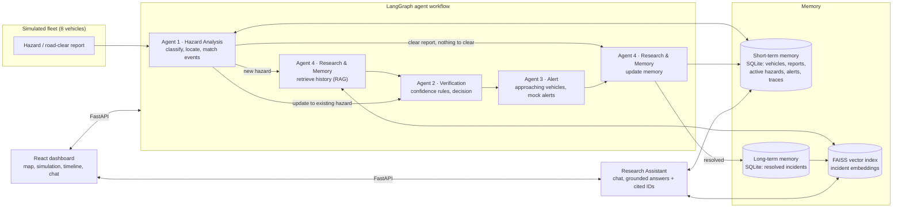

# Autonomous Vehicle Intercommunication Safety Agent System

**Author:** Kiran Haridas · **Program:** Carnegie Mellon University Agentic AI · **Agent option:** Research Assistant

An educational agentic AI application in which simulated autonomous vehicles share hazard reports. Agents
verify the reports, warn only the vehicles heading toward the hazard, learn from feedback, and explain
every decision with cited evidence.

> **Simulation only.** All vehicles, roads, incidents and alerts are synthetic. Alerts are advisory and never
> control a vehicle. The confidence rules are demonstration rules, not automotive safety standards.

---

## 1. The problem

An autonomous vehicle normally decides using only its own sensors. In dense fog, a vehicle cannot see a
stopped truck 500 m ahead, even though another vehicle that is already beside the truck can. This system is a
**shared safety intelligence layer**: it collects reports from the fleet, checks whether they are reliable, and
sends warnings to the vehicles that need them.

A single LLM prompt is not enough for this. The agent has to:
- link reports that arrive at different times;
- track confidence as evidence comes in;
- work out which vehicles are actually on an affected path;
- retract a hazard when the road is clear;
- remember outcomes for next time.

## 2. Architecture



| Layer | Technology |
|---|---|
| Backend API | Python, FastAPI |
| Agent workflow | LangGraph (`backend/agents.py`) |
| Memory | SQLite (`backend/memory.py`, `backend/database.py`) |
| RAG | TF-IDF or sentence-transformer embeddings in a FAISS index (`backend/rag.py`) |
| LLM | Mock by default; optional Anthropic or OpenAI (`backend/llm.py`) |
| Frontend | React + Vite + TypeScript, Tailwind CSS, Recharts, Leaflet with OpenStreetMap |
| Data | JSON files in `data/`: 8 vehicles, 5 road segments, 20 incidents, 5 scenarios |

```
autonomous-vehicle-agent/
├── backend/
│   ├── main.py         FastAPI endpoints
│   ├── agents.py       LangGraph workflow (agents 1-4) and process_report()
│   ├── tools.py        agent tools, confidence rules, simple road geometry
│   ├── memory.py       short-term and long-term memory
│   ├── rag.py          embeddings, FAISS index, metadata pre-filter, MMR
│   ├── research.py     Research Assistant (grounded Q&A with evidence IDs)
│   ├── llm.py          mock / Anthropic / OpenAI answer phrasing
│   ├── simulation.py   step-by-step scenario runner
│   └── database.py     SQLite schema and helpers
├── frontend/src/       App.tsx, pages/, components/
├── data/               roads.json, vehicles.json, incidents.json, scenarios.json
├── tests/              pytest tests
├── requirements.txt
└── .env.example
```

## 3. How the agent system works

Each vehicle report is one run through the LangGraph:

1. **Hazard Analysis Agent.** Classifies the hazard type and turns "500 m ahead" into a position on the road.
   It then calls `find_matching_hazards()` to check whether the hazard is already being tracked (same segment,
   same carriageway, within 50 m). If it is, it loads the earlier reports with `get_vehicle_reports()`.
   Otherwise it opens a new hazard event.
2. **Research & Memory Agent (retrieve).** Runs only for new hazards. It calls `retrieve_similar_incidents()`
   to search long-term memory for similar past incidents and computes a small, capped history adjustment.
3. **Verification Agent.** Calls `verify_hazard()`, which applies the confidence rules and chooses an action.
4. **Alert Agent.** Calls `find_approaching_vehicles()` to find vehicles on the same segment and direction,
   behind the hazard and within 3 km. It then sends messages with `send_mock_alert()`:
   - a verified alert;
   - a caution advisory;
   - an observation request ("please report what you see");
   - an all-clear once the hazard is resolved.

   Vehicles on the opposite carriageway, or already past the hazard, are not alerted. A vehicle never gets
   the same message type twice.
5. **Research & Memory Agent (update).** Calls `update_hazard_memory()` to save the report and hazard. When a
   hazard is resolved, it writes the outcome to long-term memory and rebuilds the RAG index.

### Confidence rules

| Event | Effect |
|---|---|
| First report | confidence = 0.50 |
| Independent confirmation (different vehicle, within 2 minutes) | +0.20 |
| A vehicle reports the road is clear | −0.30 |
| Each similar past incident that was confirmed / was a false report | +0.05 / −0.05 (total capped at ±0.15) |

Confidence is always kept between 0 and 1.

| Result | Decision |
|---|---|
| ≥ 0.60 | **Verified alert** |
| 0.40 – 0.60 | **Caution advisory** |
| < 0.40 | **Wait for more evidence**: send observation requests to approaching vehicles |
| 2 independent clear reports, or a clear report drops confidence below 0.20 | **Resolve** the hazard |

Two further rules:
- **Safety exception:** a high-severity hazard in visibility under 200 m always gets at least a caution advisory.
- **Low visibility:** visibility under 200 m raises severity by one level.

## 4. Agentic AI concepts demonstrated

### ReAct
Every node follows **Reason, then Act with a tool, then Observe the result**, and the observation decides the
next step. Each step is written to an execution trace that shows four fields: Reason, Action, Tool and Result.
The Agent Activity page displays this trace. For example:

- **Reason:** "Does this report describe a hazard we are already tracking?"
- **Action:** `find_matching_hazards(ROAD-01, forward, 3500, stopped_truck)`
- **Observation:** "Match found: HZ-001 (confidence 0.50)"
- **Next:** load the earlier reports, then verify.

The LangGraph's conditional edge is a ReAct decision: what Hazard Analysis observes decides whether the agent
retrieves history, goes straight to verification, or only records the report.

The decisions themselves use transparent rules, so they are easy to test and explain. The trace records the
agent's decisions, tool calls and results; it does not contain hidden model reasoning.

### Tool usage
The agents' tools are plain Python functions in `backend/tools.py`:
- `get_vehicle_reports()`
- `find_matching_hazards()`
- `verify_hazard()`
- `find_approaching_vehicles()`
- `retrieve_similar_incidents()`
- `send_mock_alert()`
- `update_hazard_memory()`

### Memory
- **Short-term memory** holds the live situation: vehicle positions, reports, active hazards, alerts sent and
  traces. It is what links Vehicle B's confirmation to Vehicle A's report 40 seconds earlier, and what stops
  duplicate alerts. **Reset Scenario** clears it.
- **Long-term memory** holds resolved incidents: 20 synthetic historical incidents plus every incident the agent
  learns during the session, each with its outcome (confirmed or false report) and a lesson. It persists across
  scenarios. **Reset All Memory** restores the 20 seed incidents.

### RAG
- **Chunks:** each incident is one chunk, a metadata header followed by the narrative, for example
  `flooding | underpass | heavy rain [SEP] Standing water across both lanes...`. Prefixing the title like this
  follows Dense Passage Retrieval (Karpukhin et al., 2020).
- **Index:** chunks are embedded and stored in a FAISS inner-product index.
  - The default embedding is TF-IDF, which runs offline with nothing to download.
  - Set `EMBEDDINGS=sentence-transformers` to use `all-MiniLM-L6-v2`.
- **Retrieval:** a metadata **pre-filter** on hazard type, then a similarity threshold, then ranking:
  - **Confidence scoring** uses the top 3 by pure relevance, because this is a narrow, precision-critical query.
  - **Research questions** use the top 5 with **MMR** (λ = 0.5, Carbonell & Goldstein, 1998), so a broad
    question gets varied incidents instead of near-duplicates.
- **Cold start (Checkpoint 3.1):** semantic retrieval only changes confidence on segments with fewer than 3 past
  incidents. Segments with their own history use an exact lookup of that history instead. Live evidence always
  outweighs history: one road-clear report (−0.30) beats the full ±0.15 history effect.

The **Flooding** scenario shows retrieval changing the outcome. Without retrieval the score would be 0.50, a
caution advisory. With three similar confirmed underpass floods retrieved, it becomes 0.65, a verified alert
telling the vehicle to reroute.

### Feedback loop
Road-clear reports lower confidence and resolve hazards. The resolved outcome is stored in long-term memory and
the RAG index is rebuilt, so the next similar report is scored with that outcome. For example, after the fog
scenario, I-580 has a confirmed stopped-truck incident of its own. Replaying the scenario without resetting
memory starts at 0.55 instead of 0.50.

### Research Assistant (agent option)
The chat answers questions using stored event data and retrieved incidents, never invented facts. Every answer
lists the record IDs it used as evidence:
- `HZ-…` hazards
- `RPT-…` reports
- `ALT-…` alerts
- `INC-…` incidents

With the default mock LLM, answers are assembled from those records. With `LLM_PROVIDER=anthropic` or `openai`,
the same records are sent to a real model with instructions to answer only from them and cite IDs. If the call
fails, the mock answer is shown.

## 5. How to run

**Requirements:** Python 3.10+ (tested on 3.12) and Node.js 20+. No API keys are needed.

```bash
cd autonomous-vehicle-agent

# Backend
python3 -m venv .venv
source .venv/bin/activate
pip install -r requirements.txt
uvicorn backend.main:app --reload --port 8000

# Frontend (second terminal)
cd frontend
npm install
npm run dev            # opens http://localhost:5173 (proxies /api to port 8000)
```

**Single-server option:** run `npm run build` in `frontend/`, then start uvicorn. The backend serves the
dashboard at http://localhost:8000.

**Optional real LLM:** copy `.env.example` to `.env` and set:
- `LLM_PROVIDER=anthropic` with `ANTHROPIC_API_KEY` (default model `claude-opus-5-5`), or
- `LLM_PROVIDER=openai` with `OPENAI_API_KEY` and `OPENAI_MODEL`.

**Tests:**

```bash
pytest -q
```

The tests check that:
- hazard reports are processed;
- independent confirmations raise confidence;
- clear reports lower confidence and resolve hazards;
- only approaching vehicles are alerted;
- historical incidents can be retrieved;
- retrieval changes a cold-start decision;
- research answers cite records that actually exist;
- a full scenario runs through the API.

## 6. Demonstrating the five scenarios

Open **Hazard Simulation**, click a scenario card, then press **Next Step** to advance one agent decision at a
time. Each step shows the alerts sent, the full agent trace and the live map. **Reset Scenario** restarts the
current scenario. **Reset All Memory** also forgets incidents learned during the session, so the numbers below
are reproduced exactly.

| # | Scenario | What to point out |
|---|---|---|
| 1 | **Stopped truck in fog** (main demo) | A reports, 0.50 (caution advisory to C) → B confirms, 0.70 (**verified alert** to C, 1100 m away). D on the opposite carriageway is not alerted. Ask "Why was an alert generated for Vehicle C?" → two road-clear reports bring it to 0.40, then **resolved**. An all-clear is sent and the incident is stored as `INC-021`. |
| 2 | **Road accident** | I-680 has its own accident history (+0.10), so the first report is already 0.60. Two confirmations take it to 1.00. Northbound Vehicle E is not alerted. |
| 3 | **Flooding** | Cold-start road: RAG retrieves 3 confirmed underpass floods (+0.15), so 0.65 gives a **verified alert: reroute**. The trace shows "Without retrieval the score would be 0.50 (caution advisory)". |
| 4 | **False hazard report** | A radar-only debris report: similar past radar-only reports were false (−0.15), so 0.35 means **wait**. An observation request goes to Vehicle F. F reports clear, 0.05, resolved as a **false report** and learned. |
| 5 | **Road cleared** | Confirmed debris on Dublin Blvd, then two independent clear reports resolve it. Ask "What has long-term memory learned from feedback?" |

The other pages:
- **Agent Activity** has each run as a seven-stage pipeline. Click a stage to focus on it; skipped stages are
  dashed.
- **Vehicle Map**: click a vehicle or hazard for its details.
- **Fleet Dashboard** has the summary charts.
- **Research Assistant** lets you ask your own questions.

## 7. References

- Lewis, P., et al. (2020). Retrieval-Augmented Generation for Knowledge-Intensive NLP Tasks. NeurIPS.
- Karpukhin, V., et al. (2020). Dense Passage Retrieval for Open-Domain Question Answering. EMNLP.
- Carbonell, J., & Goldstein, J. (1998). The Use of MMR, Diversity-Based Reranking. SIGIR.
- Yao, S., et al. (2023). ReAct: Synergizing Reasoning and Acting in Language Models. ICLR.
- Shinn, N., et al. (2023). Reflexion: Language Agents with Verbal Reinforcement Learning.
- Map data © OpenStreetMap contributors. The road network is a simplified, approximate sketch of Dublin, CA.
